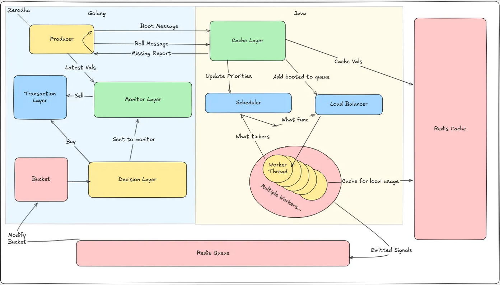

# Tyche

> A distributed, real-time trading system focused on fairness, scalability, and low-latency engineering.

**Tyche** is named after the Greek goddess of fortune, embodying both good and bad luck. (Fun fact: the name was inspired during a God of War gaming session — it just made sense!)

Tyche is a fully autonomous, real-time, distributed, load-balanced trading bot. The **Go gateway owns the entire market-data plane**: it streams real Indian market data, pushes candles into the Java core, consumes strategy signals through Redis, and executes them in a thread-safe **paper-trading** ledger. The Java core is compute-only: scheduling, indicator math, and strategy execution. A standalone Python backtester lets you evaluate the same strategy families on real history before letting them run.

> **Paper trading only.** The autonomous decision path routes every fill to an in-memory paper ledger. There is no live order adapter. Do not point this at a real account without adding explicit execution, risk, and monitoring layers.

## Features

- **One data-plane owner** — the Go gateway is the only component that talks to Yahoo Finance, Kite Connect, or the synthetic feed. The Java core never makes outbound market-data or broker calls.
- **Real market data** — Yahoo Finance chart/spark endpoints by default; Zerodha Kite Connect v3 when credentials are supplied. The symbol universe is resolved automatically from NSE's official index-constituent CSVs (`nifty50` through `nifty500`, plus mid/small-cap indices), with `TYCHE_SYMBOLS` as an explicit override. The `fake` source remains available for offline demos.
- **Autonomous loop** — bootstrap history → roll updates → indicators/signals → Redis signal queue → confidence/risk checks → paper fills → stop-loss/take-profit/time exits. No human input required.
- **Cross-language boundary** — the single proto source lives in `gateway/proto/stockrec.proto`. Java stubs are generated from it and committed for clean-checkout builds.
- **Live status API** — the Go gateway exposes an in-memory JSON snapshot of decisions, fills, cash, equity, open positions, closed trades, signals, and feed health. No separate monitoring service.
- **Fair scheduling** — boot jobs pre-empt rolling jobs, rolling work is FIFO per priority, and a bounded per-ticker candle cache prevents memory growth.
- **Large strategy library** — 90 registrations across five timeframes, grouped into trend, momentum, mean-reversion, breakout, volume, volatility, and price-action families. Every strategy shares one boot/roll lifecycle.
- **Correlation-aware signals** — the gateway aggregates the strongest decayed signal per strategy family and adds a small consensus bonus, so five correlated trend signals cannot masquerade as five independent votes.
- **Resilience** — HTTP retries, stale-ticker detection and re-boot, graceful shutdown, Redis-optional operation, and per-ticker failure isolation.
- **Backtesting** — real Yahoo/yfinance/CSV data, five strategy families with parameter overrides, portfolio cash sharing, fees/slippage/stops/targets, and JSON/CSV exports.
- **Tests** — JUnit 5 for the Java core, `go test -race` for the gateway, and `unittest` for the backtester.

## Architecture



The diagram is the original high-level design; the current data flow is:

1. **Go gateway (`gateway/`)** pulls candles from Yahoo, Kite, or the fake feed and pushes them to the Java core over gRPC. It owns ticker selection, history re-boots, quote polling, and the status API.
2. **Java core (`core/`)** maintains a newest-first candle cache per `(symbol, candle size)`, runs fair scheduling across all jobs, executes the indicator functions, and publishes `Signal` JSON to Redis. It has no external HTTP or broker client. Tickers the core cannot apply are returned to the gateway, which re-boots them.
3. **Go gateway decision/monitor loop** consumes signals, applies confidence/position/sizing/cooldown checks, executes paper trades, and manages stop-loss, take-profit, max-hold, and signal-based exits.
4. **Dashboard (`monitoring/client/`)** polls the Go status API and renders the live paper portfolio, decisions, fills, positions, signals, and system health.

Communication is event-driven and designed for horizontal scalability. Fairness and backpressure live in the system, not in individual strategies.

For the original write-up, see [Let’s Go Gambling – Internal Working Explained](https://medium.com/@itsarnavsh/lets-go-gambling-2101c2a67dac).

## Quick start

### Docker Compose

```bash
cp .env.example .env       # optional; sane defaults are built in
docker compose up --build
```

- Core gRPC: internal `core:50051`
- Status API: http://localhost:8080/api/status
- Dashboard: http://localhost:5173

The default data source is Yahoo, the default universe is the official NIFTY 500 constituent list (resolved automatically at startup), and the default mode is paper trading. Redis is required for gateway signal transport.

### Local development

Requirements: Java 21, Go 1.25+, Node 20+, Python 3.10+, tmux, and Redis (for the full loop).

The one-command local stack starts Redis, the Java core, the Go gateway, and the Svelte dashboard in a single tmux session:

```bash
cp .env.example .env   # optional; the Makefile also works without it
make tmux              # start and attach to session "tyche"
make tmux-kill         # stop every window
```

`make tmux` loads `.env` in each window, reuses an existing Redis on `127.0.0.1:6379`, waits for Redis before starting the gateway, and attaches to an existing session instead of creating a duplicate. Set `TMUX_ATTACH=0` for noninteractive startup, or use `TMUX_SESSION=name` to isolate a second stack.

### Real market data

The default `.env.example` uses `TYCHE_DATA_SOURCE=yahoo`, so a normal local start consumes real NSE market data without any credentials:

```bash
cp .env.example .env
make tmux
```

Check the feed and live watchlist:

```bash
curl -s http://localhost:8080/api/status | jq '.feed, .market'
```

The gateway resolves the symbol list automatically from NSE's official index-constituent CSV archive. `TYCHE_UNIVERSE=nifty500` is the default for real sources; `nifty50`, `nifty100`, `nifty200`, `niftynext50`, `niftymidcap150`, `niftysmallcap250`, and `niftylargemidcap250` are also supported. Set `TYCHE_SYMBOLS` to an explicit comma-separated list to override the universe for testing or a constrained run. Use `.NS` for NSE and `.BO` for BSE symbols. All execution remains paper-only; selecting a real data source changes the market data, not the ledger.

Inspect the resolved list before starting a large run:

```bash
gateway/bin/tyche-gateway universe nifty500 | head
# source=nifty500 symbols=496
# or: make universe UNIVERSE=nifty50
```

NSE's index CSV is a membership list, not a market-cap ranking. Pick `nifty50`/`nifty100` when you want the largest, most liquid names; `nifty500` is the broadest built-in option. Public Yahoo Finance can throttle hundreds of history requests, so Kite Connect is the recommended source for full NIFTY 500 runs.

Manual startup is still available:

```bash
# terminal 1 — Redis
redis-server

# terminal 2 — Java core
cd core && ./gradlew :app:run

# terminal 3 — Go gateway (Yahoo data, status API on :8080)
cd gateway && go run .

# terminal 4 — dashboard (optional; polls the gateway)
cd monitoring/client && npm install && npm run dev
```

Useful shortcuts:

```bash
make tmux          # Redis + core + gateway + dashboard in tmux
make tmux-attach   # attach to an existing tyche session
make tmux-kill     # stop the tyche session
make test          # Java + Go + Python suites
make test-dashboard  # dashboard type-check and production build
make universe      # print the resolved NSE universe (UNIVERSE=nifty500)
make backtest      # real-data backtest with the default universe
make build         # installDist + gateway binary
make proto         # regenerate Go and Java stubs from gateway/proto/stockrec.proto
make up / down     # Docker Compose stack
```

## Strategy library

Strategies live in `core/app/src/main/java/org/Tyche/src/core/engine/Scheduler/Functions/` and are registered in `FunctionAlloter`. The current library has 90 registrations:

| Timeframe | Registrations | Focus |
| --- | ---: | --- |
| `sec5` | 4 | fast SMA/EMA, RSI(2), volume breakout |
| `sec30` | 8 | EMA cross, StochRSI, Williams %R, MFI, OBV trend |
| `min1` | 40 | full library |
| `min15` | 23 | trend, momentum, volume, volatility and price-action setups |
| `hour1` | 15 | slower trend and money-flow confirmation |

Families are `trend`, `momentum`, `mean_reversion`, `breakout`, `volume`, `volatility`, and `price_action`. A strategy extends `BaseFunction`, implements one `evaluate` method, and receives `Boot`/`Roll` lifecycle behavior for free. The gateway uses the emitted `family` field to avoid double-counting correlated signals; repeated emissions from the same strategy and timeframe replace each other.

## Status API

The gateway serves a read-only JSON snapshot from memory:

```bash
curl -s http://localhost:8080/api/status | jq
```

It includes:

- `portfolio`: initial cash, current cash, market value, equity, realised/unrealised/total PnL, fees, buy/sell and win/loss counts.
- `positions`: quantity, entry, live price, market value, PnL, stop/target, confidence, and hold metadata.
- `decisions`: the recent BUY/SELL attempts with fill/rejection status and reason.
- `closed_trades`: completed round trips with exit reason and holding time.
- `signals`: recent Redis signals before aggregation, including strategy and candle size.
- `market`: the live watchlist with prices plus family-aware aggregate and peak confidence.
- `feed`: data source, resolved universe source, symbols, core/Redis connectivity, last roll/boot, and missing-ticker diagnostics.
- `stats` and `risk`: event counters and the active sizing/exit controls.

The dashboard defaults to `http://<current-host>:8080/api/status`. Override it with `?api=http://host:port/api/status` if the gateway is behind a different host or proxy.

## Data sources

Set `TYCHE_DATA_SOURCE` **on the gateway only**. The Java core no longer reads any market-data configuration.

| Value | Description | Requirements |
| --- | --- | --- |
| `yahoo` (default) | Public Yahoo chart/spark endpoints, `.NS` suffix applied to bare NSE tickers | Network access |
| `zerodha` / `kite` | Kite Connect v3 historical candles and batched LTP/OHLC quotes | API key, secret, daily access token |
| `fake` | Deterministic synthetic candles for offline development | None |

Yahoo's `/v7/finance/quote` endpoint now requires a crumb/cookie, so Tyche uses `/v8/finance/chart` for history and `/v8/finance/spark` for batched latest prices. Spark requests and Kite LTP requests are chunked, and history downloads use a bounded worker pool (`TYCHE_BOOT_WORKERS`) so a larger universe does not serialise startup.

### Automatic NSE universe

The gateway resolves `TYCHE_UNIVERSE` before it starts the market-data producer. It downloads the official NSE archive CSV (no session cookie required), keeps only `Series == EQ` rows, and de-duplicates the symbols. The source is reported in the status feed as `universe`.

NSE's newer JSON endpoint (`/api/equity-stock-indices?index=NIFTY%20500`) can return constituents sorted by traded value, but it is unofficial and requires a browser session cookie plus a referer. Tyche uses the official archive CSV because it is stable and works without a session.

| `TYCHE_UNIVERSE` | Approx. EQ symbols | Notes |
| --- | ---: | --- |
| `nifty50` | 50 | Largest, most liquid names |
| `niftynext50` | 50 | Next-tier large caps |
| `nifty100` | 100 | NIFTY 50 + Next 50 |
| `nifty200` | 200 | Large/mid-cap blend |
| `nifty500` (default) | ~496 | Broad market; best with Kite |
| `niftymidcap150` | ~150 | Mid caps |
| `niftysmallcap250` | ~250 | Small caps |
| `niftylargemidcap250` | ~250 | Large + mid caps |

The resolver tries both `archives.nseindia.com` and `nsearchives.nseindia.com`. If both downloads fail, it falls back to `TYCHE_UNIVERSE_FALLBACK` (ten liquid NSE names by default) and logs the error, so an NSE outage does not prevent a constrained run. Set `TYCHE_UNIVERSE=off` to use the fallback list intentionally. `TYCHE_UNIVERSE_LIMIT` caps the fetched list after filtering, which is useful for smoke tests. With `TYCHE_DATA_SOURCE=fake`, the automatic universe is off by default so offline demos never touch the network; set `TYCHE_UNIVERSE` explicitly to simulate a real index with synthetic prices. The universe is NSE-specific, so keep `TYCHE_YAHOO_SUFFIX=.NS` (the default) when using the Yahoo source.

### Zerodha Kite Connect

The one-time login flow lives in the Go gateway alongside the data plane:

1. Create an app at <https://developers.kite.trade> and set a redirect URL.
2. Put `TYCHE_KITE_API_KEY` and `TYCHE_KITE_API_SECRET` in `.env` (Compose passes them to the gateway). For a local install, export them from `.env` first:

   ```bash
   set -a; . ./.env; set +a
   make build
   ```

3. Print the login URL and open it in a browser:

   ```bash
   docker compose run --rm gateway kite-login-url
   # or, with a local install:
   gateway/bin/tyche-gateway kite-login-url
   ```

4. After login, copy the `request_token` from the redirect URL and exchange it:

   ```bash
   docker compose run --rm gateway kite-session <request_token>
   ```

5. Put the printed token in `.env` as `TYCHE_KITE_ACCESS_TOKEN`, set `TYCHE_DATA_SOURCE=zerodha`, and restart the stack. Kite access tokens expire daily.

## Backtesting

The standalone backtester has no dependency on the running stack:

```bash
python3 -m backtest \
  --symbols RELIANCE.NS,TCS.NS,HDFCBANK.NS,INFY.NS,ICICIBANK.NS \
  --period 2y \
  --strategy sma \
  --cash 100000 \
  --source yahoo
```

Strategies: `sma_cross`, `rsi_reversion`, `macd_trend`, `bollinger_reversion`, `donchian_breakout` (aliases such as `sma`, `rsi`, `macd`, `bollinger`, `donchian` are accepted). Override parameters with repeatable `--param key=value`.

Execution model:

- Signals are generated on a bar close and executed at the **next bar's open**.
- Cash is shared across symbols; position sizing respects `--max-positions` and `--position-fraction`.
- Fees and slippage are applied per side in basis points (default 5 bps each).
- Optional stop-loss, take-profit, and max-hold-bar exits; stops are checked before targets.
- Positions are liquidated at the final bar by default.

Other sources:

```bash
--source yfinance                      # optional convenience wrapper
--source csv --csv-dir /path/to/csvs    # <SYMBOL>.csv with OHLCV columns
```

Exports: `--json-out metrics.json`, `--trades-out trades.csv`, `--equity-out equity.csv`.
Data is cached under `~/.cache/tyche-backtest` (override with `--cache-dir`; an empty value disables caching).

## Configuration

The gateway reads market-data, execution, and status settings. The core reads only engine/Redis settings. See [`.env.example`](.env.example) for the full list. The most important ones:

| Variable | Default | Used by | Meaning |
| --- | --- | --- | --- |
| `TYCHE_DATA_SOURCE` | `yahoo` | gateway | `yahoo`, `zerodha`, or `fake` |
| `TYCHE_UNIVERSE` | `nifty500` (real) | gateway | Auto NSE index (`nifty50` … `nifty500`, `niftymidcap150`, `niftysmallcap250`, `niftylargemidcap250`) or `off` |
| `TYCHE_UNIVERSE_URL` | empty | gateway | Optional full CSV URL for a mirror or controlled run |
| `TYCHE_UNIVERSE_LIMIT` | `0` | gateway | Cap the resolved symbol count; `0` keeps the full index |
| `TYCHE_UNIVERSE_FALLBACK` | 10 NSE names | gateway | Symbols used when the NSE download fails |
| `TYCHE_SYMBOLS` | empty | gateway | Explicit override; wins over `TYCHE_UNIVERSE` when set |
| `TYCHE_BOOT_WORKERS` | `4` | gateway | Bounded parallel history downloads during boot |
| `TYCHE_WORKER_THREADS` | available CPUs | core | Scheduler worker pool; raise for large universes |
| `TYCHE_BOOT_GRACE_MS` | `300000` | core | Grace window for queued boot work before its roll data is treated as missing |
| `TYCHE_CACHE_MAX_CANDLES` | `1500` | core | Per-(symbol, timeframe) candle cache cap |
| `TYCHE_CORE_ADDR` | `localhost:50051` | gateway | Java gRPC address |
| `TYCHE_REDIS_ADDR` | `localhost:6379` | gateway | Redis address |
| `TYCHE_REDIS_HOST` / `_PORT` | `localhost` / `6379` | core | Redis address |
| `TYCHE_REDIS_ENABLED` | `true` | core | Allow Redis-less degraded mode |
| `TYCHE_SIGNAL_QUEUE` | `signal` | gateway + core | Redis list used for signals |
| `TYCHE_BOOT_CANDLES` | `300` | gateway | Historical bars requested per series |
| `TYCHE_ROLL_INTERVAL_MS` | `5000` | gateway | Latest-price poll interval |
| `TYCHE_REBOOT_BACKOFF_MS` | `10000` | gateway | Initial retry delay after a failed series boot |
| `TYCHE_REBOOT_MAX_BACKOFF_MS` | `120000` | gateway | Maximum exponential retry delay |
| `TYCHE_REBOOT_MAX_ATTEMPTS` | `0` | gateway | Attempt cap for transient boot failures; `0` retries indefinitely. Permanent HTTP 4xx failures are blacklisted immediately |
| `TYCHE_STATUS_ADDR` | `:8080` | gateway | Status API listen address (Compose fixes this at `:8080`) |
| `TYCHE_STATUS_PORT` | `8080` | Compose | Host port mapped to the status API |
| `TYCHE_INITIAL_CASH` | `100000` | gateway | Paper account starting cash |
| `TYCHE_PAPER_FEE_BPS` | `0` | gateway | Paper fill fee in basis points |
| `TYCHE_MIN_CONFIDENCE` | `0.70` | gateway | Minimum signal confidence |
| `TYCHE_MAX_POSITIONS` | `5` | gateway | Concurrent paper positions |
| `TYCHE_MAX_POSITION_FRACTION` | `0.15` | gateway | Max fraction of equity per entry |
| `TYCHE_STOP_LOSS_PCT` / `TAKE_PROFIT_PCT` | `0.05` / `0.10` | gateway | Exit thresholds (0 disables) |
| `TYCHE_HOLD_MS` | `86400000` | gateway | Maximum holding time |
| `TYCHE_REBUY_COOLDOWN_MS` | `300000` | gateway | Per-symbol re-entry cooldown |
| `TYCHE_SIGNAL_COOLDOWN_MS` | `60000` | core | Per-strategy/symbol signal cooldown |
| `TYCHE_KITE_API_KEY` / `_SECRET` / `_ACCESS_TOKEN` | empty | gateway | Kite credentials |

Durations accept plain milliseconds or Go-style strings such as `5s`/`1m` in the gateway. Invalid values fall back to defaults.

## Project layout

```
core/       Java 21 engine: scheduling, cache, indicators, strategies, gRPC boundary
gateway/    Go data plane + execution: providers, gRPC client, risk, ledger, monitor, status API
backtest/   Python research: data loaders, strategies, engine, metrics, CLI, tests
monitoring/ Svelte dashboard (reads only the Go status API)
```

## Testing

```bash
# Java (JUnit 5)
cd core && ./gradlew :app:test

# Go (race detector + vet)
cd gateway && go vet ./... && go test -race ./...

# Python
python3 -m unittest discover -s backtest/tests -v

# Dashboard
cd monitoring/client && npm run check && npm run build
```

CI runs all suites on every push and pull request.

## Scope & non-goals

Tyche is primarily an engineering and systems exploration project. It is **not** intended to be:

- A production-ready trading platform
- A profit-optimized trading strategy
- A consumer-facing trading product

The emphasis is on architecture, concurrency, fault tolerance, and data-flow design. There is no real-money execution adapter, no compliance layer, and no guarantee that any strategy is profitable.

## Motivation

Most trading bots focus on strategies and profitability. Tyche intentionally flips that priority — treating trading as a stress test for distributed systems design.

The project explores real-time data pipelines, backpressure and flow control, fairness under concurrent load, and cross-language system boundaries.

## Project status

Tyche is an active research/engineering project and is evolving rapidly. APIs and internal behavior may change without notice.
